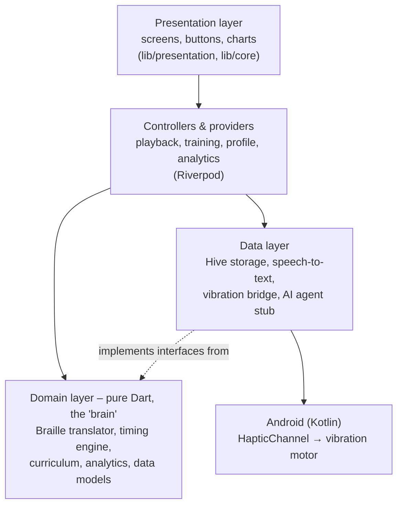

# HaptiBraille

**Read any text through your phone's vibration, privately, without sound, without a screen, and without buying expensive hardware.**<br>
**Website:** [rbksh.github.io/HaptiBraille](https://rbksh.github.io/HaptiBraille/)<br>
Contributors and their roles<br>: 1.Shesh Shiromani: End-to-end prototype development and presentation<br> 2.Manish Singh: Idea and testing<br> 3. Bhuvan M & Rajeeva MJ: Logistics<br>
HaptiBraille is a mobile app (Android only, iOS planned) that turns written text into
**Braille made of vibrations**. A person who is blind, deafblind, or has low vision can hold the
phone in their hand or pocket and *feel* each letter as a short rhythm of taps and spaces.

This document explains the whole project from the very beginning: the problem, why it matters,
the idea behind the solution, how the app works inside, every technology used, what each
important piece of code does, and how to run it. No prior knowledge is assumed; all technical words
are explained the first time they appear, and there is a [glossary](#22-glossary) at the end.

---

## Table of contents

1. [The problem](#1-the-problem)
2. [Why this matters](#2-why-this-matters)
3. [Our idea in one paragraph](#3-our-idea-in-one-paragraph)
4. [Braille basics (for people who have never seen it)](#4-braille-basics-for-people-who-have-never-seen-it)
5. [The big challenge: one motor, six dots](#5-the-big-challenge-one-motor-six-dots)
6. [Our solution: Temporal Vibrotactile Braille](#6-our-solution-temporal-vibrotactile-braille)
7. [Fighting "sensory blur": the timing settings](#7-fighting-sensory-blur-the-timing-settings)
8. [What the app can do (features)](#8-what-the-app-can-do-features)
9. [A walk through every screen](#9-a-walk-through-every-screen)
10. [The training programme in detail](#10-the-training-programme-in-detail)
11. [Progress & analytics: how every number is calculated](#11-progress--analytics-how-every-number-is-calculated)
12. [Tech stack: languages, frameworks and packages](#12-tech-stack-languages-frameworks-and-packages)
13. [How the code is organised (architecture)](#13-how-the-code-is-organised-architecture)
14. [The journey of one letter: from text to vibration](#14-the-journey-of-one-letter-from-text-to-vibration)
15. [Important code, explained line by line](#15-important-code-explained-line-by-line)
16. [Accessibility: how the app serves blind, deaf and low-vision users](#16-accessibility-how-the-app-serves-blind-deaf-and-low-vision-users)
17. [Where data is stored and what is stored](#17-where-data-is-stored-and-what-is-stored)
18. [Ready for AI: the extension points](#18-ready-for-ai-the-extension-points)
19. [Testing: how we know it works](#19-testing-how-we-know-it-works)
20. [How to install, run and build](#20-how-to-install-run-and-build)
21. [Current limitations and what comes next](#21-current-limitations-and-what-comes-next)
22. [Glossary](#22-glossary)

---

## 1. The problem

People who are **blind** or **deafblind** (both blind and deaf) need a way to read digital text:
messages, notifications, emails, anything on a phone. Today they have two main options, and both
have serious problems.

| Option | How it works | The problem |
|---|---|---|
| **Screen reader** (TalkBack on Android, VoiceOver on iPhone) | The phone reads text out loud. | **No privacy** — everyone nearby hears your bank code or private message. **Useless for deafblind people**, who cannot hear it. Hard to use in noisy places. |
| **Refreshable Braille display** | A separate device with little pins that pop up and down to form Braille letters under your fingers. | **Very expensive** — usually thousands of dollars. Another device to carry and charge. Out of reach for most people, especially in developing countries. |

So a deafblind person who cannot afford a Braille display may have **no practical way at all** to
read a text message on their own.

There is a second problem: **the skill gap**. According to our research, only about **1 in 10**
blind and deafblind people can currently recognise vibration patterns and turn them into text.
So even a perfect technology is not enough — people also need a simple way to *learn* it.

## 2. Why this matters

- **Privacy and dignity.** Reading your own messages without the whole bus hearing them is a basic right.
- **Deafblind people are often completely left out.** Sound-based tools do not work for them at all.
- **Cost.** Almost everyone already owns a smartphone, and every smartphone already has a vibration
  motor. A software-only solution costs the user nothing extra.
- **Independence.** If someone can read texts by touch and let other people "talk" to them through
  the phone, they need less help from others in daily life.

## 3. Our idea in one paragraph

Every phone has **one small vibration motor**. Braille letters are made of **six dots**. We cannot
make six separate vibrations at the same place at the same time — but we *can* play the six dots
**one after another, in time**, like a short drum rhythm. A raised dot becomes a short **tap**; a
flat dot becomes a short **silence**. By feeling the rhythm, the user knows which dots are raised,
and so which letter it is. We call this **Temporal Vibrotactile Braille** ("temporal" = spread over
time, "vibrotactile" = felt as vibration). Because learning this takes practice, the app also
includes a step-by-step **training course**, **progress charts**, and a **"talk to me" mode** that
lets any hearing person speak a message that the user then feels.

## 4. Braille basics (for people who have never seen it)

Braille is a reading system made of raised dots that people read with their fingertips.
Each letter is a small rectangle called a **cell** with room for **six dots**, numbered like this:

```
  1 ● ● 4
  2 ● ● 5
  3 ● ● 6
```

Each letter is a different combination of raised dots. A few examples:

```
  a = dot 1            b = dots 1,2          c = dots 1,4          h = dots 1,2,5

  ● ·                  ● ·                   ● ●                   ● ·
  · ·                  ● ·                   · ·                   ● ●
  · ·                  · ·                   · ·                   · ·
```

Some cells do not stand for a letter but change the meaning of the next cell. These are called
**indicators**:

| Indicator | Dots | Meaning |
|---|---|---|
| Capital | 6 | The next letter is a capital (A instead of a) |
| Capital word | 6, 6 | The whole next word is in CAPITALS |
| Number | 3, 4, 5, 6 | The next letters a–j are digits 1–0 (so "a" means 1, "b" means 2 …) |
| Letter (grade 1) | 5, 6 | "This really is a letter, not a digit" (used after numbers) |

There are two common levels of English Braille. **Grade 1** spells every word letter by letter.
**Grade 2** uses short-cuts (one cell for "the", "and", etc.). HaptiBraille uses **Grade 1, Unified
English Braille (UEB)** — the international standard — because it is the easiest to learn.

## 5. The big challenge: one motor, six dots

A real Braille reader touches all six dots **at the same time** — it is a little 2D picture.
A phone has only **one motor**, which can only be "on" or "off" (and sometimes stronger or weaker).
It cannot make a picture.

So we turn **space into time**: we play dot 1, then dot 2, then dot 3 … up to dot 6, one after the
other. But this creates a new danger, which we call **sensory blur**:

> If taps come too fast, or the pauses are too short, the brain cannot tell them apart.
> Three quick taps feel like one long buzz, and the user cannot tell "b" (dots 1,2) from "l" (dots 1,2,3).

Everyone's sense of touch is different. Beginners need slow, clear rhythms; experts want speed.
So the app must let each user **tune every timing** precisely — down to the millisecond
(1 millisecond = 1/1000 of a second).

## 6. Our solution: Temporal Vibrotactile Braille

Here is exactly how one letter is played. Every cell always has **six "slots"**, played in order.

```
time ─────────────────────────────────────────────────────────────────────────▶

[tick]  gap  [slot 1]  gap  [slot 2]  gap  [slot 3]  gap  [slot 4]  gap  [slot 5]  gap  [slot 6]

 tick   = a very short, soft "start of letter" tap (optional, on by default)
 slot   = TAP (motor on) if that dot is raised, or SILENCE if that dot is flat
 gap    = a short silence between slots
```

Example — the letter **h** (dots 1, 2, 5) with the standard settings:

```
 tick  ·  TAP  ·  TAP  ·  ___  ·  ___  ·  TAP  ·  ___
       1       2       3       4       5       6
```

The user counts the six beats after the soft tick: beats 1, 2 and 5 were taps → dots 1, 2, 5 → **h**.

**Why the soft "tick" at the start?** Without it, a letter that begins with flat dots — like
**i** (dots 2, 4) — starts with *silence*. The user cannot know when the letter began, so they
cannot count which beat a tap fell on. The tick is a short, weaker pulse (12 ms at 35% strength by
default) that marks "a new letter starts now". It can be turned off in Settings.

Between letters there is a longer silence; between words there is an even longer one. That is how
the user knows where letters and words end.

## 7. Fighting "sensory blur": the timing settings

All timings live in one object called the **haptic profile** (`HapticProfileModel`). "Haptic"
means "related to the sense of touch". The user can change every value with a slider.

| Setting (name in code) | What it is | Default | Allowed range |
|---|---|---|---|
| Dot pulse length (`dotDuration`) | How long one tap lasts | 40 ms | 10–200 ms |
| Empty dot pause (`emptySlotDuration`) | How long a flat dot's silence lasts | 50 ms | 10–500 ms |
| Pause between dots (`intraCharPause`) | Silence between two slots of the same letter | 100 ms | 20–1000 ms |
| Pause between letters (`interCharPause`) | Silence between two letters | 300 ms | 50–3000 ms |
| Pause between words (`spacePause`) | Silence between two words | 600 ms | 100–5000 ms |
| Dot strength (`intensity`) | How strong a tap is (0–100%) | 100% | 10–100% |
| Start-of-letter tick (`cellAnchorEnabled`) | Play the soft tick before each letter | On | On / Off |
| Tick strength (`anchorIntensity`) | How strong the tick is | 35% | 10–100% |

There are three ready-made **presets**:

| Preset | Dot | Empty | Between dots | Between letters | Between words |
|---|---|---|---|---|---|
| Beginner | 50 ms | 80 ms | 150 ms | 500 ms | 1000 ms |
| Standard | 40 ms | 50 ms | 100 ms | 300 ms | 600 ms |
| Fast | 30 ms | 40 ms | 70 ms | 200 ms | 450 ms |

**Safety checks.** The app warns the user when a combination of settings is likely to cause blur.
These rules are in `validate()` (`lib/domain/entities/haptic_profile_model.dart:161`):

- **Error:** "Pause between letters" must be **longer** than "Pause between dots" — otherwise letters run together.
- **Warning:** "Pause between letters" should be at least **twice** the "Pause between dots".
- **Error:** "Pause between words" must be **longer** than "Pause between letters".
- **Warning:** taps shorter than **20 ms** may be too weak on phones with older motors.
- **Warning:** a tick that is almost as strong as a dot may be mistaken for a dot.

**How long does a letter take?** With Standard settings and the tick on, the letter **h** takes:
tick 12 + gap 100 + (3 taps × 40) + (3 silences × 50) + (5 gaps × 100) = **882 ms**, a little under one second.

## 8. What the app can do (features)

| Feature | What it does | Who it helps |
|---|---|---|
| **Read** | Type, paste or dictate any text, or receive a demo notification, and feel it as Braille. | Everyone who wants to read privately |
| **Talk to me** | A hearing person speaks into the phone; the words are converted to text and then vibrated. | Deafblind users talking with hearing people |
| **Train** | A 3-level course: single dots → letters → three-letter words, with scoring and feedback. | Beginners (the 9 in 10 who cannot yet read vibrations) |
| **Explore the alphabet** | Tap any letter to feel it and see its dots — no score. | Learning and revision |
| **Progress** | Streak, accuracy, reading speed (words per minute), practice time, charts and a data table. | Users, teachers, family; deaf users can *see* their progress |
| **Settings** | Presets and sliders for every timing and strength, safety warnings, delete-all-data. | Fitting the rhythm to each person's touch |
| **Animated Braille cell** | On screen, each dot lights up exactly when it vibrates. | Sighted helpers, teachers, low-vision users, demo videos |
| **Haptic answer feedback** | Two light taps = correct, one long buzz = wrong. | Deafblind learners, who cannot see or hear "Correct!" |
| **Data export** | Copies all learning data as JSON for an AI assistant. | Future AI coaching |

## 9. A walk through every screen

**Welcome (first launch only).** An animated Braille cell spells out "H-A-P-T-I", lighting each dot
in turn. It shows the "1 in 10" fact and two buttons: **Start learning** (goes to training) or
**I already read Braille** (goes to Home). The choice is saved so this screen only appears once.

**Home.** A greeting ("Good morning/afternoon/evening"), your current streak, a big **Continue
training** card showing your level and recent accuracy, and four large tiles: **Read**,
**Talk to me**, **Train**, **Progress**. The settings button is at the top right.

**Read.** At the top, a live panel with a big Braille cell and your text; the letter being felt is
highlighted in yellow and a progress bar shows how far along it is. Below: a text box and buttons
for **Paste**, **Dictate** (speak instead of typing), **Demo notification** (fills in a sample
message like "Bus 42 arrives in 3 minutes." and plays it), **Clear**, and a big **Play / Stop** button.

**Talk to me.** Instructions for the hearing person ("Hand the phone to the person you are
with…"), a large pulsing microphone button, the live words as they are recognised, a switch
"Vibrate as soon as they finish", the live Braille panel, and a list of past messages with a
**Feel again** button on each.

**Train (hub).** Explains the course, shows the three levels as cards (locked levels show a lock and
what is needed to unlock them; each card shows recent accuracy with a marker at the 80% target),
and the **Explore the alphabet** grid of 26 letter buttons.

**Training session.** "Question 3 of 10", a progress bar, a pulsing circle that flashes with each
vibration *without revealing which dot it was*, the question ("Which letter was it?"), a
**Feel again** button, and the answer area (a 6-dot pad for Level 1, a text box plus microphone
for Levels 2–3). After answering: the correct Braille cells are revealed with their letters, a
"Correct!" / "Not quite" message, and **Next**. After 10 questions: a summary with an animated
score ring, accuracy, average answer time, and an "unlocked!" message if you just passed a level.

**Progress.** Four number tiles (day streak, accuracy, reading speed, practice time), a line chart
of accuracy by day, a line chart of reading speed by day, a bar chart of accuracy for each letter,
a "Focus on these letters" list, accuracy per level, and a **Show table** button that shows the
same numbers as a table (useful for screen readers). The share button copies all data as JSON.

**Settings.** Preset buttons (Beginner / Standard / Fast), **Feel a sample (a b c)**, live safety
warnings, a slider for every timing, dot strength, the start-of-letter tick switch and strength,
and **Delete all progress** (with a confirmation).

## 10. The training programme in detail

Code: `lib/domain/training/curriculum.dart` and `lib/presentation/providers/training_controller.dart`.

### The three levels

| Level | What you feel | How you answer | What it teaches |
|---|---|---|---|
| 1 · Single dots | A cell with exactly one raised dot (1–6) | Tap that dot on a big 6-dot pad | Telling a tap from a silence and counting beats |
| 2 · Letters A–Z | One letter | Type it, or say it ("bee", "the letter b") | The 26 letter rhythms |
| 3 · Three-letter words | A word like *cat*, *sun*, *box* (50 words) | Type it or say it | Reading letters in a row, real reading |

### One session

A session is **10 questions**. Each question goes through these steps (called *phases* in the code):

```
 playing ──▶ answering ──▶ feedback ──▶ (next question … ) ──▶ finished
    ▲             │
    └─ Feel again ┘
```

1. **Playing** — the question vibrates. The screen only shows a flashing circle so sighted users cannot cheat.
2. **Answering** — a stopwatch starts *when the vibration ends*, to measure how long the user takes to answer.
3. **Feedback** — the answer is checked, saved, and the phone gives a haptic signal (two light taps = correct, one long buzz = wrong). The correct cells are revealed on screen.
4. After the 10th question, a **summary** is shown.

### Unlocking the next level

A level counts as **mastered** when, over your **last 20 answers** on it, you have at least **10
answers** and **80% or more** are correct. Mastering a level unlocks the next one. Once a level is
unlocked it never locks again. (`isUnlocked`, `curriculum.dart:47`)

### Smart (adaptive) practice

Letters and words you get wrong come up **more often**. Each item gets a weight:

- never seen before → weight **2**
- seen before → weight **1 + 3 × (fraction wrong)** — so an item you always miss has weight 4, one you always get right has weight 1

Then the next question is picked at random, but heavier items are more likely. The same item is
never asked twice in a row. (`_weightedPick`, `curriculum.dart:94`)

### Understanding spoken and typed answers

Speech recognisers often write letter names as words. The `AnswerParser` (`curriculum.dart:147`)
cleans every answer before checking it:

- lower-cases it and removes punctuation (`" Cat. "` → `cat`)
- removes phrases like "the letter", "dot", "number", "word" (`"the letter Q"` → `q`)
- Level 1: number words become digits (`"three"` → `3`, also `"to"`/`"too"` → `2`, `"for"` → `4`)
- Level 2: letter names become letters (`"bee"` → `b`, `"see"`/`"sea"` → `c`, `"double you"` → `w`, `"why"` → `y`, `"zed"`/`"zee"` → `z`, and more)

## 11. Progress & analytics: how every number is calculated

Code: `lib/domain/analytics/analytics_calculator.dart`. Every answer is saved as a
**training attempt** (what was asked, what was answered, right or wrong, how long it took, how long
the vibration was, how many replays, and the timing settings used at that moment).

| Number | How it is calculated |
|---|---|
| **Accuracy** | correct answers ÷ all answers |
| **Day streak** | How many days in a row you practised, ending today or yesterday. If your last practice was 2+ days ago, the streak is 0. **Best** = longest run ever. |
| **Reading speed (WPM)** | Uses only Level 2 and 3 answers. *Words per minute* = (correctly read letters ÷ 5) ÷ (minutes of vibration felt). Dividing by 5 is the standard typing-speed convention: 5 letters = 1 "word". Shown for your last 50 answers. |
| **Practice time** | For each answer: vibration length × (1 + replays) + answer time, added up. |
| **Letter accuracy** | For each letter of the alphabet: correct ÷ tries. |
| **Focus letters** | Letters with at least 3 tries and below 70% accuracy, weakest first. |
| **Level accuracy** | Accuracy for all answers at each level. |

**Example of WPM:** you correctly read "cat" (3 letters) and wrongly read "dog"; each word vibrated
for 6 seconds. Correct letters = 3 → 0.6 words. Time = 12 seconds = 0.2 minutes. 0.6 ÷ 0.2 = **3 WPM**.
(This exact example is checked by an automated test.)

**Charts.** Built with the `fl_chart` package. They show only one data series each (so no legend
is needed — the title names it), use a teal colour (`#1FA2B5`) that was checked with a colour
validator for good contrast on the dark background, show a tooltip when touched, and each chart has
a spoken summary for screen readers (for example *"Accuracy chart over 5 days. Started at 60%, latest 90%."*).
A **table view** shows the same numbers as text.

## 12. Tech stack: languages, frameworks and packages

### Languages

| Language | Used for | Where |
|---|---|---|
| **Dart** | Almost all of the app: screens, logic, Braille translation, timing engine, training, analytics, storage, tests | `lib/`, `test/` |
| **Kotlin** | The Android-only part that talks directly to the vibration motor | `android/app/src/main/kotlin/com/haptibraille/app/` |
| **Swift** | iOS app shell (generated by Flutter). The iOS vibration code is not written yet. | `ios/Runner/` |
| **Kotlin DSL (Gradle)** | Android build settings (app ID, Java version, SDK versions) | `android/app/build.gradle.kts` |
| **XML** | Android app manifest: app name and permissions (vibrate, microphone) | `android/app/src/main/AndroidManifest.xml` |
| **Property list (XML)** | iOS app name and microphone/speech permission messages | `ios/Runner/Info.plist` |
| **YAML** | List of packages, fonts and versions | `pubspec.yaml` |

### Framework and tools

| Tool | Version used | What it is and why we use it |
|---|---|---|
| **Flutter** | 3.47.9 (stable) | Google's toolkit for building one app that runs on both Android and iOS from a single codebase. Saves writing the app twice. |
| **Dart SDK** | 3.13.7 | The programming language Flutter uses. |
| **Android SDK** | platform 36/37, build-tools 36 | Google's tools to build Android apps. |
| **Android NDK** | 28.2.13676358 | Native build tools that Flutter's Android build requires. |
| **Gradle** | 9.3.1 | The program that builds the Android app (APK). |
| **Java / JDK** | 17 (bundled with Android Studio) | Gradle and Kotlin run on Java. |

### Packages (libraries) and what each one does

Declared in `pubspec.yaml`.

| Package | Version | What it is | What we use it for |
|---|---|---|---|
| `flutter_riverpod` | ^2.5.1 (2.6.1 installed) | **State management**: a clean way to share data between screens and update the screen when data changes. | Sharing the haptic profile, the training session, the playback state, the list of attempts and the analytics between screens. Also lets tests swap real parts for fake ones. |
| `hive` | ^2.2.3 | A small, fast **database** that stores data on the phone. | Saving the haptic profile, the "welcome screen seen" flag, and every training attempt. |
| `hive_flutter` | ^1.1.0 | Connects Hive to Flutter (finds the right folder on the phone). | `Hive.initFlutter()` in `main.dart`. |
| `speech_to_text` | ^7.5.0 | Uses the phone's built-in **speech recognition**. | Talk to me, Dictate, and spoken training answers. |
| `fl_chart` | ^1.3.0 | A **chart** library. | Accuracy and reading-speed line charts, letter-accuracy bar chart. |
| `clock` | ^1.1.3 | A replaceable "current time". | Measuring playback and answer times in a way that automated tests can control. |
| `flutter_test` | (SDK) | Flutter's testing tools. | Unit and widget tests. |
| `flutter_lints` | ^4.0.0 | Code style rules. | Keeps the code clean; `flutter analyze` reports 0 issues. |

**Font:** *Atkinson Hyperlegible* (`assets/fonts/`), designed by the **Braille Institute** for
people with low vision — letters that are easy to confuse (like I, l and 1) are made clearly
different. Free under the SIL Open Font License (`assets/fonts/OFL.txt`).

**Why no ready-made "vibration" package?** Typical vibration packages only offer "vibrate for X
ms". We need **millisecond-exact rhythms** with **different strengths**, played as **one
uninterrupted pattern** so the timing never drifts. So we wrote our own small bridge straight to
Android's `VibrationEffect` API (see [section 15.5](#155-the-android-vibration-code-kotlin)).

## 13. How the code is organised (architecture)

The project follows **Clean Architecture**: the code is split into layers, and each layer has one job.
Inner layers do not know about outer layers, so parts can be replaced (for example, swapping the
Braille translator for an AI-powered one) without touching the rest.



- **Domain** = the rules of the app (what Braille is, how timing works, how to score answers).
  It is *pure Dart*: no screens, no phone hardware. This makes it easy to test and reuse.
- **Data** = talking to the outside world (the database, the microphone, the motor).
- **Presentation** = what the user sees and touches.
- **Interfaces** (contracts) live in the domain, for example `ITextProcessor`, `IHapticPlayer`,
  `ISpeechInput`, `ISettingsRepository`. The data layer provides the real versions; tests provide fake ones.

### Folder map

```
lib/
├── main.dart                         Starts the app, opens the database
├── app.dart                          The app shell: theme, first screen (Welcome or Home)
├── core/                             Shared building blocks
│   ├── theme/app_theme.dart          Colours, font sizes, button styles
│   ├── motion.dart                   Animations that respect "reduce motion"
│   └── widgets/
│       ├── braille_cell_view.dart    The animated 6-dot cell + the 6-dot answer pad
│       └── common.dart               Tiles, stat boxes, section titles, message boxes
├── domain/                           The "brain" (pure Dart)
│   ├── entities/
│   │   ├── braille_cell.dart         A Braille cell, a token, a translated document
│   │   ├── haptic_profile_model.dart All timing settings + validation + presets
│   │   ├── haptic_sequence.dart      A fully timed vibration pattern
│   │   └── training.dart             Levels, questions, saved answers
│   ├── engine/
│   │   ├── braille_translator.dart   Text → Braille cells (Grade 1 UEB)
│   │   ├── haptic_translation_engine.dart  Braille cells → timed vibration pattern
│   │   └── feedback_patterns.dart    "Correct" and "wrong" vibrations
│   ├── training/curriculum.dart      Questions, unlocking, adaptive picking, answer cleaning
│   ├── analytics/analytics_calculator.dart  Streaks, accuracy, WPM, JSON export
│   ├── repositories/repositories.dart       Storage contracts
│   └── services/                     Contracts: text processor, haptic player, speech input
├── data/                             Talking to the outside world
│   ├── datasources/platform/
│   │   ├── haptic_method_channel.dart  Sends patterns to Android
│   │   └── haptic_platform_codec.dart  Converts patterns to Android / iOS formats
│   ├── repositories/
│   │   ├── hive_repositories.dart      Real storage on the phone
│   │   └── in_memory_repositories.dart Fake storage for tests
│   ├── speech/speech_to_text_input.dart  Microphone → text
│   └── agent/agent_service.dart        Placeholder for the future AI agent
└── presentation/
    ├── providers/                    Shared state (Riverpod)
    │   ├── app_providers.dart        Storage, speech, attempts, analytics, onboarding
    │   ├── haptic_providers.dart     Translator, engine, motor, profile
    │   ├── playback_controller.dart  Plays patterns + drives the animation
    │   └── training_controller.dart  Runs a 10-question session
    ├── widgets/live_playback_panel.dart  Big cell + highlighted text + progress bar
    └── screens/  welcome, home, reader, talk, training (hub + session), analytics, settings

android/app/src/main/kotlin/com/haptibraille/app/
├── MainActivity.kt                   Android entry point; registers the vibration bridge
└── HapticChannel.kt                  Plays the vibration pattern on the motor

test/                                 28 automated tests (see section 19)
assets/fonts/                         Atkinson Hyperlegible font files + licence
```

## 14. The journey of one letter: from text to vibration

What happens when you type **"Hi"** and press **Play**:

```
 "Hi"
   │  1. BrailleTranslator (Dart)            text → cells
   ▼
 H → [capital ⠠][h ⠓]     i → [i ⠊]
   │  2. HapticTranslationEngine (Dart)      cells + your timing settings → timed pattern
   ▼
 tick 12ms · pause 100 · TAP 40 · pause 100 · … (every on/off with its exact length)
   │  3. HapticPlatformCodec (Dart)          pattern → two lists of numbers for Android
   ▼
 timings    = [12, 100, 40, 250, …]   (how long each piece lasts, in ms)
 amplitudes = [89,   0, 255,  0, …]   (how strong: 0 = off, 255 = full)
   │  4. MethodChannel "haptibraille/haptics"  Dart → Kotlin bridge
   ▼
   │  5. HapticChannel.kt (Kotlin)           VibrationEffect.createWaveform(timings, amplitudes)
   ▼
 📳 The phone's motor plays the whole rhythm in one go.
   │  6. PlaybackController (Dart) at the same time, 60 times a second:
   ▼
 "Which dot is vibrating right now?" → lights that dot on screen and highlights the letter.
```

Because the **whole pattern is sent to Android in a single call**, the motor's timing is exact even
if the screen is busy. The on-screen animation follows along using a clock.

## 15. Important code, explained line by line

### 15.1 A Braille cell is just a number

`lib/domain/entities/braille_cell.dart:11`

```dart
class BrailleCell {
  const BrailleCell(this.mask) : assert(mask >= 0 && mask <= 0x3F);
  final int mask;

  bool isRaisedAt(int slot) => mask & (1 << slot) != 0;
  String get unicode => String.fromCharCode(0x2800 + mask);
}
```

- A cell is stored as **one small number** (`mask`) from 0 to 63. Each of its 6 *bits* (on/off
  switches) is one dot: bit 0 = dot 1, bit 1 = dot 2 … bit 5 = dot 6. For example "h" (dots 1, 2, 5) =
  1 + 2 + 16 = **19**.
- `isRaisedAt(slot)` checks if a dot is raised using the `&` (bitwise AND) operator.
- `unicode` turns the cell into the real Braille character (like ⠓) for showing on screen. Unicode
  has a Braille block starting at code `0x2800`, and its bit order is exactly the same as ours, so
  it is a simple addition.

### 15.2 Text → Braille (the translator)

`lib/domain/engine/braille_translator.dart`

The alphabet is a simple lookup table (`line 21`):

```dart
static final Map<String, BrailleCell> letters = {
  'a': BrailleCell.parse('1'),
  'b': BrailleCell.parse('12'),
  'c': BrailleCell.parse('14'),
  ...
  'z': BrailleCell.parse('1356'),
};
```

`translate()` (`line 103`) walks through the text one character at a time and:

- **spaces/new lines** → one "word break" (several spaces count as one)
- **digits** → adds the number indicator (dots 3456) before the first digit of a number, then the digit's cell (1 = a, 2 = b … 0 = j)
- **letters right after a number** (only a–j, which could be confused with digits) → adds the letter indicator (dots 56)
- **capital letters** → adds the capital indicator (dot 6). If a whole word of 2+ letters is in capitals (`NASA`), adds the capital-word indicator (6, 6) once (`_startsCapsWord`, `line 194`)
- **punctuation** → looks up a table of 27 symbols (`. , ; : ! ? ' - " ( ) / @ & # $ % * + = < > [ ] { } _ \`); opening and closing quotes are told apart
- a **decimal point inside a number** (3.5) keeps number mode on
- **characters with no Braille mapping** (like € or emoji) are skipped and their positions reported, so the screen can say "2 unsupported characters skipped"

Each character becomes a **token** that remembers its position in the text — that is how the
screen knows which letter to highlight while it vibrates.

### 15.3 Braille → timed vibration (the engine)

`lib/domain/engine/haptic_translation_engine.dart:77`

```dart
void _emitCell(_SequenceBuilder out, BrailleCell cell, HapticProfileModel p) {
  final intra = p.intraCharPause.inMilliseconds;
  ...
  if (p.cellAnchorEnabled) {                  // the soft start-of-letter tick
    out.pulse(HapticSegment(kind: HapticSegmentKind.anchor,
        durationMs: p.anchorDuration.inMilliseconds, intensity: p.anchorIntensity, ...));
    out.silence(intra);
  }
  for (var slot = 0; slot < BrailleCell.dotCount; slot++) {   // the six dots, in order
    if (slot > 0) out.silence(intra);                          // gap between dots
    if (cell.isRaisedAt(slot)) {
      out.pulse(HapticSegment(kind: HapticSegmentKind.dot,     // raised → TAP
          durationMs: p.dotDuration.inMilliseconds, intensity: p.intensity, slot: slot, ...));
    } else {
      out.silence(p.emptySlotDuration.inMilliseconds);         // flat → SILENCE
    }
  }
}
```

This is the heart of Temporal Braille in about 20 lines. Around it, `buildFromTokens()` adds the
**pause between letters** between cells, or the **pause between words** after a word break.

Silences that follow each other are **merged** into one (`_SequenceBuilder.silence`, `line 116`):
"pause 100 + empty 50 + pause 100" becomes one "silence 250". This keeps the list sent to Android short.

The result is a `HapticSequence` (`lib/domain/entities/haptic_sequence.dart`): a list of
segments ("tap 40 ms at 100%", "silence 250 ms", …). Each tap remembers **which cell and which dot**
it belongs to. `frameAt(ms)` (`line 111`) answers "at this moment, which dot is vibrating?" — used by
the on-screen animation.

The engine is **pure**: the same input always gives the same output and it never touches the
hardware. That means it can be tested exactly — for example, a test checks that the letter "a"
with no tick gives exactly `[tap 40 ms, silence 750 ms]`, 790 ms in total.

### 15.4 Pattern → Android format (the codec)

`lib/data/datasources/platform/haptic_platform_codec.dart:13`

Android's vibration API wants **two lists of the same length**: how long each piece lasts, and how
strong it is (0 = off, 1–255 = strength).

```dart
for (final s in sequence.segments) {
  timings.add(s.durationMs);
  amplitudes.add(switch (s) {
    HapticSegment(isSilent: true) => 0,                    // silence → motor off
    _ when !hasAmplitudeControl => -1,                     // phone can't vary strength → "default"
    _ => (s.intensity * 255).round().clamp(1, 255),        // 0–100% → 1–255
  });
}
```

There is also `toCoreHapticsEvents()` (`line 34`), which prepares the same pattern for iPhone's
Core Haptics (dots as "continuous" events of exact length, the tick as a crisp "transient" click).
It is ready for when the iOS side is written.

### 15.5 The Android vibration code (Kotlin)

Dart cannot touch the motor directly, so Flutter provides a **method channel**: a named "phone
line" between Dart and Kotlin. Ours is called `"haptibraille/haptics"`.

Dart side — `lib/data/datasources/platform/haptic_method_channel.dart:10`:

```dart
await _channel.invokeMethod<void>(
  'playWaveform',
  HapticPlatformCodec.toAndroidWaveform(sequence, hasAmplitudeControl: caps.hasAmplitudeControl),
);
```

Kotlin side — `android/app/src/main/kotlin/com/haptibraille/app/HapticChannel.kt:88`:

```kotlin
private fun play(v: Vibrator, timings: LongArray, amplitudes: IntArray) {
    v.cancel()                                               // stop anything already playing
    if (Build.VERSION.SDK_INT < Build.VERSION_CODES.O) {     // very old phones (Android 7)
        v.vibrate(toLegacyPattern(timings, amplitudes), -1)  // simple on/off pattern
        return
    }
    ...
    val effect = VibrationEffect.createWaveform(timings, amps, -1)   // -1 = play once, don't repeat
    if (Build.VERSION.SDK_INT >= Build.VERSION_CODES.TIRAMISU) {     // Android 13+
        v.vibrate(effect, VibrationAttributes.createForUsage(VibrationAttributes.USAGE_ACCESSIBILITY))
    } else {
        v.vibrate(effect)
    }
}
```

- `createWaveform` is the Android feature that plays a whole on/off/strength pattern with
  millisecond accuracy, handled by the operating system itself.
- On Android 13 and newer we mark the vibration as **accessibility** use. This means it still works
  even if the user has turned off "touch vibration" in system settings.
- The channel also answers `getCapabilities` (does the phone have a motor? can it vary strength?)
  and `cancel` (stop now).
- `MainActivity.kt` registers this channel when the app starts.

### 15.6 Playing and animating at the same time

`lib/presentation/providers/playback_controller.dart`

`playSequence()` (`line 68`) sends the pattern to the motor, notes the start time, and starts a
timer that fires about **60 times per second**. Each time, `_tick()` (`line 99`):

1. works out how many milliseconds have passed,
2. asks the sequence which dot is vibrating (`frameAt`) and which letter (`tokenAt`),
3. updates the screen **only if something changed** (to save battery),
4. stops when the pattern is finished.

If the device cannot vibrate (for example a computer during development), the animation still runs
and the screen says so. Only one thing vibrates at a time: starting a new playback stops the old one.

### 15.7 Running a training session

`lib/presentation/providers/training_controller.dart`

- `_nextTrial()` (`line 79`) asks the curriculum for the next question (avoiding the previous
  answer), then plays it.
- When playback ends, the phase becomes **answering** and the answer stopwatch starts.
- `submit()` (`line 115`) stops any vibration, checks the answer with the `AnswerParser`, saves a
  `TrainingAttempt` (with a snapshot of the current timing settings, so later we can see which
  speeds work best), and plays the correct/wrong vibration.

### 15.8 Speech to text

`lib/data/speech/speech_to_text_input.dart:36`

```dart
await _speech.listen(
  onResult: (r) => onResult(r.recognizedWords, r.finalResult),
  listenOptions: SpeechListenOptions(
    partialResults: true,                       // show words while they are being spoken
    listenMode: dictation ? ListenMode.dictation : ListenMode.confirmation,
    listenFor: Duration(seconds: dictation ? 60 : 8),   // longest listening time
    pauseFor: Duration(seconds: dictation ? 4 : 2),     // stop after this much silence
  ),
);
```

- **Dictation mode** (Talk to me, Read) listens up to 60 seconds for whole sentences.
- **Confirmation mode** (training answers) listens briefly for one letter or word.
- In Talk to me, when the speaker stops, the final text is saved to the message list and — if
  "Vibrate as soon as they finish" is on — played immediately.

### 15.9 Saving data

`lib/data/repositories/hive_repositories.dart:9`

```dart
Future<void> saveProfile(HapticProfileModel profile) => _box.put('profile', profile.toJson());
Future<void> addAttempt(TrainingAttempt attempt) => _box.add(attempt.toJson());
```

Everything is stored as plain **JSON-style maps** (text keys and simple values) — no special
binary formats — so the data stays readable by people and by AI tools.

### 15.10 Starting the app

`lib/main.dart:9`

```dart
Future<void> main() async {
  WidgetsFlutterBinding.ensureInitialized();
  await Hive.initFlutter();                                   // find the app's storage folder
  final settings = await Hive.openBox<dynamic>('settings');   // open the two "tables"
  final attempts = await Hive.openBox<dynamic>('attempts');
  runApp(ProviderScope(
    overrides: [                                              // plug real storage into the app
      settingsRepositoryProvider.overrideWithValue(HiveSettingsRepository(settings)),
      analyticsRepositoryProvider.overrideWithValue(HiveAnalyticsRepository(attempts)),
    ],
    child: const HaptiBrailleApp(),
  ));
}
```

The `overrides` line is how Riverpod lets us "plug in" parts: the real app uses Hive storage,
while tests plug in fake in-memory storage instead.

## 16. Accessibility: how the app serves blind, deaf and low-vision users

| What | How | Where |
|---|---|---|
| **High contrast** | Dark background (`#0B0D10`) with white text and a bright yellow accent (`#FFC940`). Main text has at least 7:1 contrast. | `core/theme/app_theme.dart` |
| **Readable font** | Atkinson Hyperlegible, large sizes (body text 17–19 pt, headings up to 46 pt). | `pubspec.yaml`, `app_theme.dart` |
| **Big touch targets** | Buttons are at least 56–72 pt tall; answer dots are 84 pt circles. | Theme, `braille_cell_view.dart` |
| **Screen readers** (TalkBack / VoiceOver) | Every button, tile, dot and chart has a spoken label ("Dot 3, bottom left", "Braille cell, dots 1, 2, 5"); sliders speak "300 milliseconds"; headings are marked as headings. | `Semantics(...)` throughout |
| **Live announcements** | Feedback ("Correct!"), transcripts and warnings are *live regions*, so screen readers read them out automatically. | `NoticeBox`, training and talk screens |
| **Reduced motion** | If the phone's "remove animations" setting is on, every animation is turned off. | `core/motion.dart` (`reduceMotion`) |
| **No screen or sound needed** | Training feedback is given by vibration (2 light taps / 1 long buzz) for deafblind users. | `domain/engine/feedback_patterns.dart` |
| **Visual progress for deaf users** | Charts, numbers and an animated cell let deaf users *see* everything. | Progress screen |
| **Large text safe** | Layouts let text wrap or shrink instead of overflowing when the system font is large. | Fixed and tested |

## 17. Where data is stored and what is stored

- **Where:** only on the phone, in the app's private storage (Hive database). Nothing is sent to
  any server by HaptiBraille itself.
- **Speech:** the phone's built-in speech recognition is used; on most Android phones this sends
  audio to the phone maker's / Google's online service to turn it into text.
- **What:**

| Box (table) | Key | Contents |
|---|---|---|
| `settings` | `profile` | All timing settings (see the example below) |
| `settings` | `onboarded` | `true` once the welcome screen has been completed |
| `attempts` | 0, 1, 2, … | One entry per training answer |

Example of a saved profile:

```json
{
  "schemaVersion": 1, "id": "standard", "name": "Standard",
  "dotDurationMs": 40, "emptySlotDurationMs": 50, "intraCharPauseMs": 100,
  "interCharPauseMs": 300, "spacePauseMs": 600,
  "intensity": 1.0, "sharpness": 0.8,
  "cellAnchorEnabled": true, "anchorDurationMs": 12, "anchorIntensity": 0.35, "anchorSharpness": 1.0
}
```

Example of a saved training answer:

```json
{
  "timestamp": "2026-10-31T12:00:00.000Z", "level": "letters",
  "target": "b", "response": "d", "correct": false,
  "responseMs": 1840, "playbackMs": 1130, "replays": 1,
  "profileId": "standard", "dotDurationMs": 40, "intraCharPauseMs": 100, "interCharPauseMs": 300
}
```

**Delete all progress** (Settings) erases the `attempts` box.

## 18. Ready for AI: the extension points

The project was designed so that an AI assistant (an LLM agent) can be added later without
rewriting the app.

1. **`ITextProcessor`** (`lib/domain/services/i_text_processor.dart:8`) — *every* piece of text
   goes through this one interface before being vibrated. Today it is the `BrailleTranslator`.
   Later an `AgentTextProcessor` can wrap it: first ask the AI to **summarise** a long email into
   one sentence, then hand the short text to the translator. Only one line in
   `haptic_providers.dart` needs to change.
2. **`AgentService`** (`lib/data/agent/agent_service.dart:8`) — an empty placeholder class with the
   note `TODO: Integrate REST/WebSocket for AI agent communication.`
3. **Learning data as JSON** — `AnalyticsCalculator.exportJson()` (`analytics_calculator.dart:168`)
   produces a versioned report (summary, daily stats, focus letters, every answer with the speed
   settings used). The **share button** on the Progress screen copies it.
4. **Automatic speed coaching** — `HapticProfileModel.scaled(factor)` (`haptic_profile_model.dart:149`)
   slows down or speeds up all the pauses at once (but keeps tap length the same, since that depends
   on the motor, not on speed). An AI that notices the user struggling could call `scaled(1.2)`
   to slow everything down by 20%.

## 19. Testing: how we know it works

Run all tests with `flutter test`. There are **28 automated tests**, and `flutter analyze` reports
**no issues**.

| Test file | What it checks |
|---|---|
| `test/domain/haptic_core_test.dart` | Letters map to the right cells; capital and capital-word indicators; numbers and the letter indicator; whitespace handling; unsupported characters; exact timing of "a" (790 ms); word pause vs letter pause; tick before each cell; letter positions; presets are valid; bad settings are caught; sliders clamp to safe limits; `scaled` keeps tap length; settings survive saving and loading. |
| `test/domain/training_analytics_test.dart` | Level 2 unlocks only at 80% over 10+ answers; Level 1 questions have exactly one dot; no repeated question; spoken answers ("Three", "Bee", "the letter Q", "double you") are understood; streak rules; the WPM example (3 WPM); focus letters; JSON export; animation frames; Android format (`[40, 750]` / `[255, 0]`). |
| `test/presentation/app_flow_test.dart` | First launch shows Welcome, then Home; a full Level 1 question plays, accepts the right dot, saves the answer and shows "Correct!"; the Progress screen shows the streak and charts. These use a **fake motor** and **fake storage**, so they run on any computer. |

Tests also caught real bugs during development, for example text overflowing on small screens
with large fonts, and an animation curve that briefly made a shadow size negative.

## 20. How to install, run and build

### Install on a phone (no computer needed)

Download [`HaptiBraille.apk`](main-v1/release/HaptiBraille.apk) on an Android phone (Android 7 or
newer), open it and tap **Install**. If Android asks, allow installing from this source; if Play
Protect warns about an unknown app, tap **More details → Install anyway**. Speech-to-text needs an
internet connection on most phones.

### Set up a computer for development (Windows)

1. Install **Git**.
2. Install **Flutter** (e.g. `git clone https://github.com/flutter/flutter.git -b stable C:\dev\flutter`)
   and add `C:\dev\flutter\bin` to your PATH.
3. Install **Android Studio**, open it once and finish the setup wizard (this installs the Android SDK).
4. Make sure the **Android SDK Command-line Tools** and **NDK 28.2.13676358** are installed
   (Android Studio → SDK Manager → SDK Tools).
5. Run `flutter doctor` — "Android toolchain" should have a ✓.

### Run from source

```
flutter pub get        # download the packages
flutter test           # run the 28 automated tests
flutter run            # run on a phone connected by USB (USB debugging on)
```

To connect a phone: Settings → About phone → tap **Build number** 7 times → Developer options →
turn on **USB debugging** → plug in → allow the computer.

### Build an installable app file

```
flutter build apk --release
```

The file appears at `build/app/outputs/flutter-apk/app-release.apk`. It is currently signed with a
development key, which is fine for installing directly but not for the Play Store.

## 21. Current limitations and what comes next

Being honest about what is **not** done yet:

| Area | Status today | Next step |
|---|---|---|
| iPhone vibration | The iOS pattern format is ready (`toCoreHapticsEvents`), but the Swift code that plays it is **not written**. On iPhone the app shows the animation without vibration. | Write `HapticChannel.swift` using `CHHapticEngine`. |
| Real notifications | "Demo notification" fills in sample messages. | Android `NotificationListenerService` to read real notifications. |
| Braille grade | Grade 1 only (no contractions). | Optional Grade 2 for experienced readers. |
| Braille table review | The punctuation table follows UEB but has not been checked by a certified Braille transcriber. | Expert review. |
| Multiple users | One learner per phone. | Optional profiles for shared phones. |
| Speech offline | Most phones need internet for speech recognition. | Offer offline recognition where the phone supports it. |
| AI agent | Interfaces and data are ready; no AI is connected. | Summaries and automatic speed coaching. |
| Release signing | Development key. | Proper signing key and Play Store listing. |
| Real-user testing | Default timings are informed guesses. | Test with blind and deafblind users and tune the defaults. |

## 22. Glossary

| Word | Meaning |
|---|---|
| **API** | A set of functions one program offers so other programs can use it. |
| **APK** | The file format of an installable Android app. |
| **Amplitude** | How strong a vibration is (0 = off, 255 = strongest on Android). |
| **Bit / bitmask** | A bit is a single on/off value. A bitmask is a number whose bits each mean something (here: each dot). |
| **Cell** | One Braille character: a 2 × 3 grid of six dot positions. |
| **Clean Architecture** | Organising code in layers so the core rules don't depend on screens, databases or hardware. |
| **Codec** | Code that converts data from one format to another. |
| **Deafblind** | Having both hearing and vision loss. |
| **Flutter** | Google's toolkit for building apps for Android and iOS from one codebase, written in Dart. |
| **Grade 1 Braille** | Braille that spells every word letter by letter (no short-cuts). |
| **Haptic** | Related to the sense of touch; haptic feedback = vibrations you feel. |
| **Hive** | A small database that stores data on the phone. |
| **Indicator** | A Braille cell that changes the meaning of the next cell (capital, number, …). |
| **JSON** | A simple text format for data, like `{"name": "Standard"}`. |
| **Kotlin** | The modern programming language for Android. |
| **Live region** | A part of the screen that screen readers announce automatically when it changes. |
| **LLM / AI agent** | A large language model (like a chatbot) that can be given tasks such as summarising text. |
| **Method channel** | Flutter's bridge for Dart code to call native Android (Kotlin) or iOS (Swift) code. |
| **ms (millisecond)** | One thousandth of a second. 1000 ms = 1 second. |
| **NDK** | Android's Native Development Kit: tools for building low-level code, required by Flutter's Android build. |
| **Provider / Riverpod** | A way to share data and objects across the app and update the screen when they change. |
| **Screen reader** | Software that reads the screen aloud (TalkBack on Android, VoiceOver on iPhone). |
| **SDK** | Software Development Kit: the tools needed to build apps for a platform. |
| **Sensory blur** | When vibrations come too fast or too close together, so the brain can't tell them apart. |
| **Temporal Braille** | Playing the six dots of a cell one after another in time instead of all at once. |
| **Tick (cell anchor)** | A short, soft pulse that marks the start of each letter. |
| **UEB** | Unified English Braille — the international standard for English Braille. |
| **Unicode** | The worldwide standard numbering for every text character, including Braille patterns (⠁⠃⠉…). |
| **Waveform** | A pattern of on/off/strength over time, played by the vibration motor. |
| **WPM** | Words per minute; here, (correctly read letters ÷ 5) per minute of vibration. |
